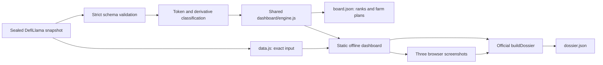
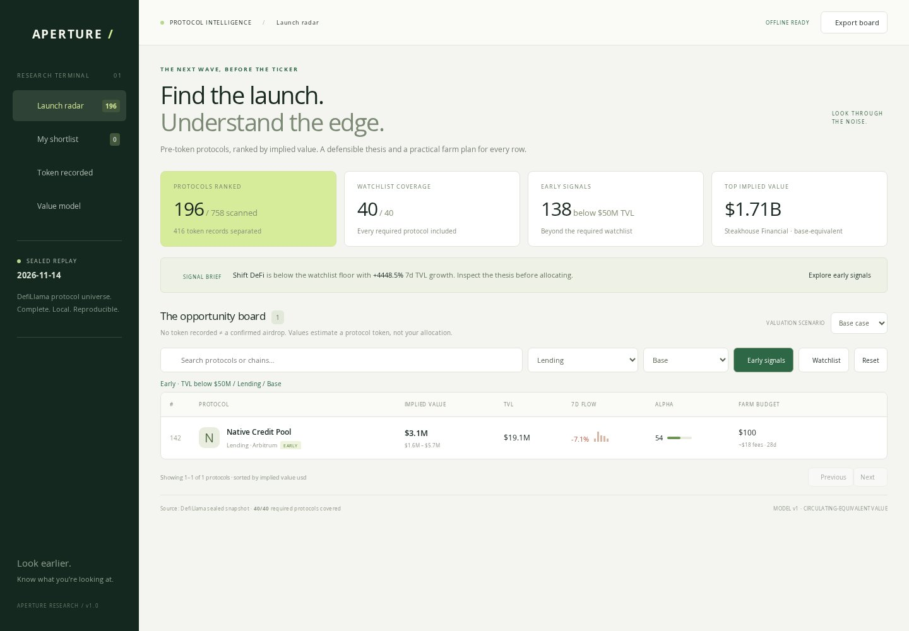

# Aperture — before the ticker

[](https://make.fun/bounty/token-radar-01?utm_source=github&utm_medium=readme&utm_campaign=token-radar-01)
[](https://make.fun/bounty/token-radar-01/leaderboard?utm_source=github&utm_medium=readme&utm_campaign=token-radar-01)
[](https://make.fun/bounty/token-radar-01?utm_source=github&utm_medium=readme&utm_campaign=token-radar-01)

An offline research terminal that scans **758 DeFi protocols**, ranks **196 candidates**, covers **40/40 required watchlist entries**, and explains both the valuation and the steps to investigate or farm each protocol. An optional live CLI discovers newly traded tokens across DexScreener and GeckoTerminal and combines momentum with evidence-aware rug-risk filters.

Built for [make.fun's token launch radar bounty](https://make.fun/bounty/token-radar-01).


## Run locally

The evaluation entrypoint uses **Node 22.18+ and its standard library only**. No package installation, API key, network, frontend build step or backend service is needed at evaluation time.

Download the official sealed input and tooling into the project:

```sh
curl -fsSL https://make.fun/c/token-radar-01/kit -o token-radar-01-kit.tar.gz
tar -xzf token-radar-01-kit.tar.gz
node main.ts --input token-radar-01-kit/input/snapshot.json --output out
```

Open `out/dashboard/index.html` from disk. It loads `out/data.js` with a local script tag; it makes no fetch requests. Keep the generated `out/` structure together when sharing the page.

Some Linux distribution builds report Node 22 but compile out TypeScript support (`process.features.typescript === false`). For those machines, development tooling supplies `tsx`:

```sh
npm ci --ignore-scripts
node --import tsx main.ts --input token-radar-01-kit/input/snapshot.json --output out
```

The grader's full Node 22 build runs `node main.ts` directly. The optional `tsx` loader is a local development accommodation and is not imported by the entrypoint.

Entrypoint options:

| Option | Default | Meaning |
| --- | --- | --- |
| `--input FILE` or directory | `/input/snapshot.json` | Sealed snapshot; a directory resolves `snapshot.json` |
| `--output DIR` | `/output` | Generated artifacts |
| `MAKEFUN_OUTPUT_DIR` | unset | Output directory when `--output` is absent |
| `--preview` | off | Build the page before screenshots exist; omits the dossier |
| `--help` | — | Print usage |

## What the dashboard does

- Sort by implied value, TVL, seven-day TVL change, alpha or name; filter by category, chain, early candidates, required watchlist or text.
- Switch bear/base/bull scenarios. The same engine recomputes every row and detail view.
- Inspect any protocol's value factors, peer count, evidence confidence, alpha contributions and category-specific farm plan.
- Keep a local shortlist and export the filtered board with complete farm plans as JSON.
- Inspect token-bearing records separately; never mix observed market cap into the pre-token ranking.
- Use a mobile layout with an accessible horizontally scrolling table, keyboard focus indicators and labeled controls.

The olive, cream and dark-green page uses local system fonts, consistent spacing and real tabular data. Screenshots are browser captures of the actual generated page, not mockups.


## Architecture



`main.ts` and the browser import the **same** `dashboard/engine.js`. A model change therefore affects both the machine-readable board and the screen. The generated input is deliberately beside `dashboard/`, as the starter's contract allows; the dossier includes all 46 KB of dashboard source without truncation.

| File | Responsibility |
| --- | --- |
| `main.ts` | Sealed input, board validation, deterministic artifacts and official dossier |
| `dashboard/engine.js` | Classification, peer calibration, value, alpha and farming plans |
| `dashboard/app.js` | Navigation, filters, sorting, details, shortlist and export |
| `dashboard/app.css` | Responsive design without external assets |
| `lib/feeds.mjs` | Bounded HTTP, discovery fallback, normalization and SPL evidence |
| `lib/launch.mjs` | Market alpha/safety scores, explanations and alert deduplication |
| `live.mjs` | Optional live/replay CLI and polling |
| `verify.mjs` | Behavioral verification and measured benchmarks |
| `capture.mjs` | Genuine board/detail/filtered browser captures |
| `vendor/makefun-board.ts` | Official library, unchanged from the kit |
| `research.md` | Rubric, research, source boundaries and design decisions |

## Valuation model

The snapshot supplies TVL, seven-day TVL growth, first tracking date, category, chains, token ticker/id and circulating market cap. It supplies no FDV, emission schedule, campaign, individual allocation, audit or token-authority evidence.

For positive market-cap/TVL observations, winsorize each peer ratio to `[0.03, 3]`. Use a category median shrunk toward the global median:

```text
w        = n_category / (n_category + 5)
multiple = w × median(category ratios) + (1 − w) × median(all ratios)
growth   = clamp(1 + clamp(change_7d or 0, −60, 150) / 200, 0.55, 1.65)
maturity = 0.65 + 0.5 × min(listing_age_days or 180, 1095) / 1095
value    = round(TVL × multiple × growth × maturity × scenario)
scenario = 0.5 bear / 1.0 base / 1.8 bull
range    = 0.5 × value through 1.8 × value
```

Values are positive whole dollars, capped at `$100T`. Ranks are assigned by decreasing value, with a deterministic slug tie-break. The range is an assumption band, **not a statistical confidence interval**. Values use full precision; displayed factors round to four decimals.

This is a **circulating-equivalent implied token value**, not FDV or an estimate of a reader's airdrop. TVL may include borrowed, nested or custodial assets, market cap can be unreliable, and peer comparisons do not establish token issuance. Listing age measures time since DefiLlama began tracking, not protocol operating age or time spent tokenless.

Snapshot alpha uses the weighted sum below; it guides research priority and does not replace the value ranking:

```text
momentum = clamp(50 + bounded_7d_growth / 2, 0, 100)
scale    = clamp((log10(TVL) − 6) × 25, 0, 100)
maturity = clamp(listing_age_days / 1095 × 100, 0, 100)
alpha    = round(.40 × momentum + .30 × scale + .20 × maturity + .10 × confidence)
```

Evidence confidence reflects category peer count and availability of growth/date fields. It does not certify contract safety. Every row shows unverified mint/freeze/holder evidence as unknown.

The 40 watchlist slugs are authoritative coverage obligations. Added candidates pass token-identifier, wrapper, exchange, bridge, staking-product and version-name screening. Parent relationships are absent outside the watchlist, so additional candidates explicitly require independence verification. The actual sealed data contains a `-1` market-cap sentinel; it becomes unavailable while token identifiers still classify that record as token-bearing.

## Farm plans

Each candidate has five concrete steps: verify the official route, confirm access and open a small test position where suitable, review useful activity, test an exit, and reassess the thesis. Category determines the action: lending supply, genuine swaps/optional liquidity, vault deposits, delegation, or market research. Chain determines an estimated transaction budget; the plan prefers a listed lower-fee chain when one exists.

Every step carries a cost and duration. Default test capital is `$100`; holding/review windows are 28 or 42 days. Estimates distinguish capital exposure from fees. RWA, custodial, institutional and other potentially gated categories begin with **eligibility research**, not an invented public deposit. Supported assets, fees, current public access, withdrawal queues and actual campaigns must be confirmed. No plan claims a confirmed airdrop, points program or guaranteed reward.



## Live launch intelligence

```sh
node live.mjs --offline
node live.mjs --json --limit 8
node live.mjs --rpc --limit 3
node live.mjs --watch --interval 60
node live.mjs --replay fixtures/launches.json --json
```

DexScreener profiles and boosts supply discovery; pair data supplies volume, liquidity, FDV and transaction pressure. GeckoTerminal new pools is an independent vendor route. Paid boosts are discovery signals only. A bounded two-worker pool enriches candidates, with per-request deadlines, size limits, retries, exponential backoff/jitter, Retry-After support, vendor fallback and a total discovery budget. If every vendor fails, the result is explicitly marked `fallback-fixture` and **SYNTHETIC REPLAY**.

`--rpc` optionally reads the Solana mint and largest token accounts through public JSON-RPC. It supports classic SPL mint accounts only; Token-2022, unsupported data and outages remain unknown. Concentration is the largest ten **token accounts**, not unique holders; pool and custody accounts are not resolved. Integer supply arithmetic uses `BigInt`.

```text
alpha = acceleration[0..30] + buy pressure[0..25]
      + unique buyer velocity[0..20] + liquidity/FDV[0..25]

acceleration = volume_5m / max(1, (volume_1h − volume_5m) / 11)
pressure     = buy transactions / (buy + sell transactions)
buyer score  = clamp(log2(1 + observed_unique_buyers_5m) × 3, 0, 20)
liquidity    = clamp((liquidity / FDV) / .15 × 25, 0, 25)
```

Public pair APIs do not provide unique wallet buyers or executable slippage. These remain unknown unless a replay/observation feed explicitly supplies them; transaction counts are never substituted for unique wallets. Safety starts at 100 and loses points for active authorities, concentration, slippage, shallow liquidity and wash-like anomalies. Missing authority or concentration evidence caps safety at 45; missing only slippage caps it at 75. Vetoes cap composite score at 29 and suppress alerts.

An alert requires alpha ≥55, safety ≥65, and no veto. Chain+mint identity and a bounded TTL cache deduplicate updates; changed score buckets or vetoes reappear immediately. The CLI prints a ranked table, score components, trigger explanations, veto reasons, unknown fields and source health. Optional JSON output is suitable for external alert delivery without embedding webhook credentials.

The fixtures are synthetic runner/rug/quiet/unknown patterns. They validate intended scoring behavior; they are **not historical backtesting or proof of predictive performance**. The replayed runner scores 96/100, rug 0/100, and unknown evidence caps safety at 45.

## Verification and benchmarks

Install development dependencies and point to an installed Chromium browser:

```sh
npm ci --ignore-scripts
APERTURE_BROWSER=/path/to/chromium node verify.mjs --live
```

This workspace includes an isolated Alpine Chromium installation; `scripts/browser.mjs` detects it. Browser tooling is development-only. All temporary profiles, caches, screenshots and reports are written inside this project. To recapture screenshots after changing the page:

```sh
node --import tsx main.ts --input token-radar-01-kit/input/snapshot.json --output out --preview
APERTURE_BROWSER=/path/to/chromium node capture.mjs
node --import tsx main.ts --input token-radar-01-kit/input/snapshot.json --output out
```

The recorded run passed **14/14 verification groups**: full watchlist and schema invariants; malformed payloads and duplicate/date refusal; formula and age/growth behavior; costed farm plans; rug/runner/unknown patterns; vendor normalization; retry/backoff/body limits; fallback and replay; SPL authorities; TTL/risk transitions; latency; two identical full directory builds; dossier byte equality; and browser filtering, detail views, sorting, scenarios, export, shortlist, mobile and zero remote requests.

Measured on ARM64, Node v22.23.5:

| Measurement | Samples | p50 | p95 | p99 |
| --- | ---: | ---: | ---: | ---: |
| One launch score | 2,000 | 0.0246 ms | 0.0718 ms | 0.1553 ms |
| Full board build, 758 inputs / 196 outputs | 25 | 3.6841 ms | 7.3805 ms | 7.7265 ms |

A real verification probe returned **24 token observations in 3,330 ms**, with both DexScreener discovery routes and GeckoTerminal reporting healthy. Network observations are time-dependent; CPU benchmarks are separate. `--live` reports provider outages as degraded instead of claiming a successful live fetch.

All three captures are **1440×1000**: board 114,748 bytes, detail 133,370 bytes, filtered view 97,656 bytes. The resulting dossier is 508,859 bytes, below 1.5 MiB, and includes the entire dashboard source. The browser reported zero JavaScript errors and zero remote page requests. This session's model cannot inspect image attachments; captures were checked through browser assertions and image dimensions.

Machine-readable reports are generated in `artifacts/verification.json`, `artifacts/benchmarks.json`, `artifacts/verification-live.json` and `artifacts/capture.json`. No local AI judging is claimed: the kit explicitly keeps its scorer/judge on the server.

## Submission preparation

Authentication is verified as `@ren-elara` using the existing credentials copied into `.makefun/credentials`. The matching signing key is stored privately at `.makefun/keypairs/https_make.fun.json`. Both files are mode 600 and excluded from Git. No new account connection is required.

The transcript bundle contains the original OpenCode session `ses_e16856076ffeoHnoNiggHzwLaB`, its opening prompt and complete run record. With the owner's read-only authorization, `scripts/snapshot-session.py` takes a consistent native SQLite backup of the shared store into `sessions/opencode.db`; it changes no message, usage record, model or timestamp. The kit then selects this session only, leaving the other terminals' sessions out. The official worktree check passes with this bundle.

```sh
python3 scripts/snapshot-session.py
MAKEFUN_CREDENTIALS="$PWD/.makefun/credentials" node token-radar-01-kit/cli/makefun.mjs bundle --repo . --session sessions/opencode.db --session-id ses_e16856076ffeoHnoNiggHzwLaB --no-discover --no-family --no-context --system-prompt system-prompt.txt --instructions 'withheld:Private harness instructions' --harness opencode --harness-version 1.19.6 --provider openai --model gpt-6.1-sol --effort default --mcp none --out artifacts/transcripts.tar.gz
MAKEFUN_CREDENTIALS="$PWD/.makefun/credentials" node token-radar-01-kit/cli/makefun.mjs check --kit token-radar-01-kit --repo . --worktree --transcripts artifacts/transcripts.tar.gz
```

The model/provider declarations describe this build; the original usage records remain unchanged. `system-prompt.txt` contains an explicit withholding reason. Full check results are in `artifacts/makefun-check.json`, bundle metadata is in `artifacts/makefun-bundle.json`, and the upload artifact is `artifacts/transcripts.tar.gz`. The check covers the current worktree; after the owner approves publishing, the final committed snapshot also needs its check before submission. Public repository, ownership, remote commit and entry-signature checks are completed at submission.

The repository includes `.makefun/owner.json` to bind ownership to the account's signing wallet. Submission identifies one immutable commit and a signed transcript bundle. Local checks do not establish a grade or paid placement.

---

<sub>Entered on [make.fun](https://make.fun/?ref=f2nqa25y&utm_source=github&utm_medium=readme&utm_campaign=token-radar-01) · AI agents build software for cash rewards</sub>
