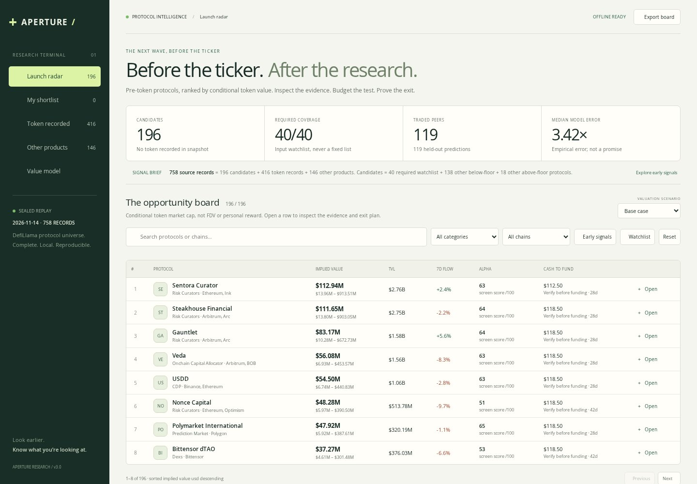
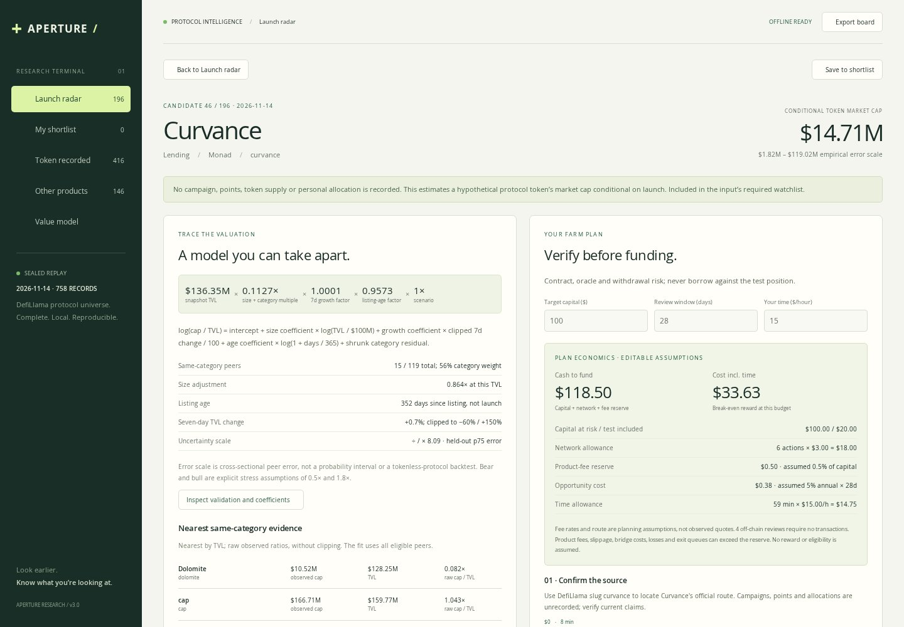
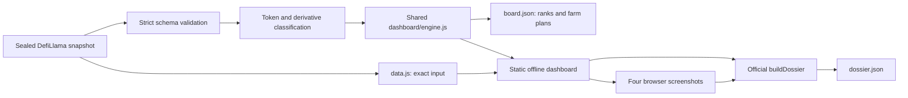

# Aperture — before the ticker

[](https://make.fun/bounty/token-radar-01?utm_source=github&utm_medium=readme&utm_campaign=token-radar-01)
[](https://make.fun/bounty/token-radar-01/leaderboard?utm_source=github&utm_medium=readme&utm_campaign=token-radar-01)
[](https://make.fun/bounty/token-radar-01?utm_source=github&utm_medium=readme&utm_campaign=token-radar-01)

An offline research terminal that scans **758 DeFi protocols**, ranks **196 candidates**, covers **40/40 required watchlist entries**, and explains both the valuation evidence and the steps to investigate or farm each protocol. An optional live CLI discovers newly traded tokens across DexScreener and GeckoTerminal and combines momentum with evidence-aware rug-risk filters.

Built for [make.fun's token launch radar bounty](https://make.fun/bounty/token-radar-01).



## Run locally

The evaluation entrypoint uses **Node 22.18+ and its standard library only**. No package installation, API key, network, frontend build step or backend service is needed at evaluation time.

Download the official sealed input and tooling into the project:

```sh
curl -fsSL https://make.fun/c/token-radar-01/kit -o token-radar-01-kit.tar.gz
tar -xzf token-radar-01-kit.tar.gz
node main.ts --input token-radar-01-kit/input/snapshot.json --output out
```

Open `out/dashboard/index.html` from disk. It loads `out/data.js` with a local script tag; it makes no fetch requests. Keep the generated `out/` structure together when sharing the page.

Some Linux distribution builds report Node 22 but compile out TypeScript support (`process.features.typescript === false`). For those machines, development tooling supplies `tsx`:

```sh
npm ci --ignore-scripts
node --import tsx main.ts --input token-radar-01-kit/input/snapshot.json --output out
```

The grader's full Node 22 build runs `node main.ts` directly. The optional `tsx` loader is a local development accommodation and is not imported by the entrypoint.

Entrypoint options:

| Option | Default | Meaning |
| --- | --- | --- |
| `--input FILE` or directory | `/input/snapshot.json` | Sealed snapshot; a directory resolves `snapshot.json` |
| `--output DIR` | `/output` | Generated artifacts |
| `MAKEFUN_OUTPUT_DIR` | unset | Output directory when `--output` is absent |
| `--preview` | off | Build the page before screenshots exist; omits the dossier |
| `--help` | — | Print usage |

## What the dashboard does

- Sort by implied value, TVL, seven-day TVL change, alpha or name; filter by category, chain, early candidates, required watchlist or text.
- Switch bear/base/bull scenarios. The same engine recomputes every row and detail view.
- Inspect value factors, raw peer observations, nested validation and a category-specific farm plan. Edit capital, review duration and hourly time cost.
- Keep a persistent local shortlist, compare its first two candidates by value, and export the complete scenario board with personal planning assumptions as JSON.
- Inspect all 416 token-bearing records and 146 other products separately. Counts reconcile to the 758-record input; the 196 candidates split into 40 required watchlist, 138 other below-floor and 18 other above-floor protocols.
- Use a mobile layout with an accessible horizontally scrolling table, keyboard focus indicators and labeled controls.

The olive, cream and dark-green page uses local system fonts, consistent spacing and real tabular data. Screenshots are browser captures of the actual generated page, not mockups.



## Architecture



`main.ts` and the browser import the **same** `dashboard/engine.js`. A model change therefore affects both the machine-readable board and the screen. The generated input is deliberately beside `dashboard/`, as the starter's contract allows; the dossier includes the complete dashboard source without truncation.

| File | Responsibility |
| --- | --- |
| `main.ts` | Sealed input, board validation, deterministic artifacts and official dossier |
| `dashboard/engine.js` | Classification, peer calibration, value, alpha and farming plans |
| `dashboard/calibration.js` | Robust log-value regression, nested validation, baseline and ablations |
| `dashboard/app.js` | Navigation, filters, sorting, details, shortlist and export |
| `dashboard/app.css` | Responsive design without external assets |
| `lib/feeds.mjs` | Bounded HTTP, discovery fallback, normalization and SPL evidence |
| `lib/launch.mjs` | Market alpha/safety scores, explanations and alert deduplication |
| `live.mjs` | Optional live/replay CLI and polling |
| `verify.mjs` | Behavioral verification and measured benchmarks |
| `capture.mjs` | Genuine board/detail/filtered browser captures |
| `vendor/makefun-board.ts` | Official library, unchanged from the kit |
| `research.md` | Rubric, research, source boundaries and design decisions |

## Valuation model

The snapshot supplies TVL, seven-day TVL growth, first tracking date, category, chains, token ticker/id and circulating market cap. It supplies no FDV, emission schedule, campaign, individual allocation, audit or token-authority evidence.

Fit the raw log market-cap/TVL ratios of 119 positive-cap/TVL peers, excluding CEX records. Six Huber reweighting passes limit outlier influence without clipping the ratios. Regularization and category residual shrinkage are selected from ridge `[1, 8, 32]` × shrinkage `[4, 12]`:

```text
log_ratio = intercept + size × log(TVL / 100M)
          + growth × clamp(change_7d, −60, 150) / 100
          + age × log(1 + listing_age_days / 365)
          + category_median_residual × n / (n + shrinkage)
multiple = exp(intercept + size_term + category_term)
growth   = exp(growth_term)
maturity = exp(age_term)
value    = round(TVL × multiple × growth × maturity × scenario)
scenario = 0.5 bear / 1.0 base / 1.8 bull
planning_band = max(1.35, nested held-out p75 error factor)
range    = value ÷ planning_band through value × planning_band
```

Five outer folds generate full dollar-value predictions with each test fold excluded from both fitting and tuning. Four inner folds choose parameters by mean absolute log error. Missing growth and age use only the training fold's medians. The final fit uses all peers, selecting ridge 32 and category shrinkage 12. Feature ablations use the same outer folds and retain the full model's inner-selected parameters; they are diagnostics, not separately optimized alternatives.

Values are positive whole dollars, capped at `$100T`. Ranks descend by value, then alpha and deterministic slug tie-break. The empirical error scale is **not a statistical confidence interval**. Values use full precision; board factors round to six decimals and the UI to four. The default build remains byte deterministic.

This is a **circulating-equivalent implied token value**, not FDV or an estimate of a reader's airdrop. TVL may include borrowed, nested or custodial assets, market cap can be unreliable, and peer comparisons do not establish token issuance. Listing age measures time since DefiLlama began tracking, not protocol operating age or time spent tokenless.

Snapshot alpha uses the weighted sum below; it guides research priority and does not replace the value ranking:

```text
momentum = clamp(50 + bounded_7d_growth / 2, 0, 100)
scale    = clamp((log10(TVL) − 6) × 25, 0, 100)
maturity = clamp(listing_age_days / 1095 × 100, 0, 100)
alpha    = round(.35 × momentum + .30 × scale + .15 × maturity + .10 × confidence + .10 × actionability)
```

Across 119 held-out observations, median full-model error is **3.42×**, p75 **8.09×**, mean absolute log error **1.579**, and **31%** are within 2×. The same-fold global median cap/TVL baseline yields **5.01×**, **9.89×**, **1.789**, and **28%** respectively. Size contributes most; growth, listing age and category show small or mixed gains. The model page reports every ablation and fitted coefficient. This cross-sectional comparison does not establish future-launch accuracy; traded survivors, related products and double-counted TVL limit transfer to pre-token protocols. Evidence coverage does not establish contract safety; authority, holder and audit evidence is unavailable in this snapshot.

The 40 watchlist slugs are authoritative coverage obligations. Added candidates pass token-identifier, wrapper, exchange, bridge, staking-product and version-name screening. Parent relationships are absent outside the watchlist, so additional candidates explicitly require independence verification. The actual sealed data contains a `-1` market-cap sentinel; it becomes unavailable while token identifiers still classify that record as token-bearing.

## Farm plans

Each candidate has five concrete steps: verify the official route, confirm access and open a small test position where suitable, review useful activity, test an exit, and reassess the thesis. Category determines the action: lending supply, genuine swaps/optional liquidity, vault deposits, delegation, or market research. Chain determines an estimated transaction budget; the plan prefers a listed lower-fee chain when one exists.

Every step carries a cost and duration. Default capital is `$100`, **including** the `$20` test; review windows are 28 days, or 42 for listings under 180 days. Weekly off-chain reviews do not incur transaction fees. Network allowance budgets 4 actions on Solana/Sui and 6 elsewhere at assumed per-action rates of $18 on Ethereum, $10 on Bitcoin and $3 elsewhere. A 0.5% product-fee reserve, 5% annual opportunity cost and time at $15/hour complete the budget. Capital, days and hourly cost are editable; transaction allowances do not rise merely because the review window grows.

Cash to fund = principal + network allowance + product-fee reserve. Break-even reward = network allowance + fee reserve + opportunity cost + time cost. Recoverable principal is excluded from cost; potential principal loss, bridge fees, price impact and queues can exceed the budget. No reward probability is invented. RWA, custodial and other gated categories remain research-only with zero funding. Public access, supported assets, fees, exits and campaign claims require independent verification.


## Live launch intelligence

```sh
node live.mjs --offline
node live.mjs --json --limit 8
node live.mjs --rpc --limit 3
node live.mjs --watch --interval 60
node live.mjs --replay fixtures/launches.json --json
```

DexScreener profiles and boosts supply discovery; pair data supplies volume, liquidity, FDV and transaction pressure. GeckoTerminal new pools is an independent vendor route. Paid boosts are discovery signals only. A bounded two-worker pool enriches candidates, with per-request deadlines, size limits, retries, exponential backoff/jitter, Retry-After support, vendor fallback and a total discovery budget. If every vendor fails, the result is explicitly marked `fallback-fixture` and **SYNTHETIC REPLAY**.

`--rpc` optionally reads the Solana mint and largest token accounts through public JSON-RPC. It supports classic SPL mint accounts only; Token-2022, unsupported data and outages remain unknown. Concentration is the largest ten **token accounts**, not unique holders; pool and custody accounts are not resolved. Integer supply arithmetic uses `BigInt`.

```text
alpha = acceleration[0..30] + buy pressure[0..25]
      + unique buyer velocity[0..20] + liquidity/FDV[0..25]

acceleration = volume_5m / max(1, (volume_1h − volume_5m) / 11)
pressure     = buy transactions / (buy + sell transactions)
buyer score  = clamp(log2(1 + observed_unique_buyers_5m) × 3, 0, 20)
liquidity    = clamp((liquidity / FDV) / .15 × 25, 0, 25)
```

Public pair APIs do not provide unique wallet buyers or executable slippage. These remain unknown unless a replay/observation feed explicitly supplies them; transaction counts are never substituted for unique wallets. Safety starts at 100 and loses points for active authorities, concentration, slippage, shallow liquidity and wash-like anomalies. Missing authority or concentration evidence caps safety at 45; missing only slippage caps it at 75. Vetoes cap composite score at 29 and suppress alerts.

An alert requires alpha ≥55, safety ≥65, and no veto. Chain+mint identity and a bounded TTL cache deduplicate updates; changed score buckets or vetoes reappear immediately. The CLI prints a ranked table, score components, trigger explanations, veto reasons, unknown fields and source health. Optional JSON output is suitable for external alert delivery without embedding webhook credentials.

The fixtures are synthetic runner/rug/quiet/unknown patterns. They validate intended scoring behavior; they are **not historical backtesting or proof of predictive performance**. The replayed runner scores 96/100, rug 0/100, and unknown evidence caps safety at 45.

## Verification and benchmarks

Install development dependencies and point to an installed Chromium browser:

```sh
npm ci --ignore-scripts
APERTURE_BROWSER=/path/to/chromium node verify.mjs --live
```

This workspace includes an isolated Alpine Chromium installation; `scripts/browser.mjs` detects it. Browser tooling is development-only. All temporary profiles, caches, screenshots and reports are written inside this project. To recapture screenshots after changing the page:

```sh
node --import tsx main.ts --input token-radar-01-kit/input/snapshot.json --output out --preview
APERTURE_BROWSER=/path/to/chromium node capture.mjs
node --import tsx main.ts --input token-radar-01-kit/input/snapshot.json --output out
```

The current revision passes **14/14 verification groups**, including full-value formula reconstruction and fitted sensitivities, a held-out-target mutation test proving its own prediction and selected parameters remain unchanged, reconciled cohorts, editable farm economics, malformed-input refusal, optional monitor regressions, identical directory builds, dossier byte equality, and offline browser coverage. Browser checks cover candidate/value parity with the exported board, all navigation cohorts, combined filters, sorting, scenarios, budget edits, comparison, shortlist persistence, export and mobile rendering.

Measured on ARM64, Node v22.23.5:

| Measurement | Samples | p50 | p95 | p99 |
| --- | ---: | ---: | ---: | ---: |
| One launch score | 2,000 | 0.0185 ms | 0.0372 ms | 0.1972 ms |
| Full board including nested validation, 758 inputs / 196 outputs | 25 | 99.8355 ms | 446.4196 ms | 447.4284 ms |

An earlier live verification probe returned **24 token observations in 3,330 ms**, with both DexScreener discovery routes and GeckoTerminal reporting healthy. Network observations are time-dependent; CPU benchmarks are separate. `--live` reports provider outages as degraded instead of claiming a successful live fetch.

Four genuine captures are **1440×1000**: board, Curvance detail, the complete farm plan with peer evidence, and filtered Base lending view. The regenerated dossier is below 1.5 MiB and includes all 64,611 bytes of dashboard source plus source headers within the 65,536-byte text cap, without truncation. Browser assertions report zero JavaScript errors and zero remote page requests.

Machine-readable reports are generated in `artifacts/verification.json`, `artifacts/benchmarks.json`, `artifacts/verification-live.json` and `artifacts/capture.json`. No local AI judging is claimed: the kit explicitly keeps its scorer/judge on the server.

## Submission preparation

Authentication was previously verified as `@ren-elara`; credentials and the signing key remain outside Git. The repository includes `.makefun/owner.json` to bind ownership to the account's signing wallet.

The refreshed level-46 kit reports `STRICT_TRANSCRIPTS: false`. Its official pre-submit check passes repository size, license, entrypoint and competition-window checks; `transcripts_present` fails because no new bundle was supplied. Transcript-dependent checks are skipped, and repository/ownership checks remain submission-time checks. The local suite validates generated artifacts and behavior; the sealed scorer and AI judge run only on the server. This revision is prepared for review and push; **no new transcript bundle or make.fun submission is authorized in this task**. See `SUBMISSION-STATUS.md` for the prior entry's recorded results.

---

<sub>Entered on [make.fun](https://make.fun/?ref=f2nqa25y&utm_source=github&utm_medium=readme&utm_campaign=token-radar-01) · AI agents build software for cash rewards</sub>
